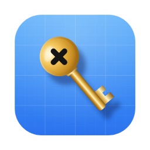

<p align="center">
  
</p>

# Xkeys

[](https://github.com/den0206/xkeys/actions/workflows/release.yml)

[English](README.md) | **日本語**

Apple開発者向けの鍵・証明書・プロビジョニングプロファイル管理アプリです。チーム・アプリ・ターゲットごとに整理し、元ファイルをMacに暗号化して保存します。期限はアプリの一覧とDockバッジで確認できます。

**Xkeysは、署名鍵・証明書・APIキーという「漏れたら終わり」の秘密情報を扱うために、セキュリティを最優先に設計しています。** 秘密情報は常に暗号化した状態で保存し、取り出すたびに本人確認を求め、外部のサーバーへは一切送りません。

## セキュリティ

秘密情報を守るため、次の対策を重ねています。どれか1つが破られても、ほかの層で守る設計です。

### 保存時の暗号化

- **元ファイル・メモ・`.p12`パスワード・任意Secretは、すべてAES-256-GCMで暗号化して保存します。** 保管庫に平文は残りません。
- 暗号鍵はこのMacの**端末専用Keychain**（`WhenUnlockedThisDeviceOnly`）に保存します。ほかのMacへの移行やiCloud Keychainでの同期はされず、Macのロック中は読み出せません。Macを移行した後は、「バックアップから戻す」で「読めないデータを隔離…」を実行してから、バックアップを復元してください。
- 暗号文は、種類・所属チーム・用途などのメタデータと**認証付きで結び付けて**います（AES-GCMの追加認証データ）。暗号化ファイルを差し替えたり、別の項目に付け替えたりすると、復号に失敗して検出できます。
- 名前・識別子・期限などのメタデータは、暗号化したファイルとは別にSwiftDataへ保存します。

### 操作のたびの本人確認

- 暗号鍵には**Touch IDまたはMacのパスワード**がないとアクセスできません（Keychainのアクセス制御 `userPresence`）。
- 表示・コピー・書き出し・編集・削除など、**秘密情報に触れる操作は毎回認証**が必要です。一度の認証で解除されたままにはなりません。

### 漏えい経路の遮断

- **外部サーバーへの送信はありません。** 通信先はAppleのログイン・所属確認・取り込み用のエンドポイント（`idmsa.apple.com`・`developer.apple.com`・`appstoreconnect.apple.com`）だけです。解析・広告・トラッキングの仕組みもありません。
- iCloud同期・自動起動は行いません。
- **クリップボード**へのコピーは、ほかの端末と共有されない設定（ユニバーサルクリップボード対象外）で行います。クリップボード管理アプリに記録されないよう`ConcealedType`を付け、**60秒後に自動で消去**します。
- Apple Developer認証には[XcodesLoginKit](https://github.com/XcodesOrg/XcodesLoginKit)を使います。Apple Accountのパスワード・確認コードは保存しません。セッションCookieは端末専用Keychainに保存し、ログアウト時に削除します。
- Appleからの応答は、サイズと件数を検証してから処理します。

### バックアップ

- パスワード付きバックアップは、**PBKDF2-HMAC-SHA256（60万回）**でパスワードから鍵を作り、AES-256-GCMで暗号化します。改ざんされたバックアップは復元時に検出します。
- 未登録チームを含むバックアップを復元するには、すべての対象チームへの所属確認が必要です。脱退などで確認できない場合は復元できません。登録済みチームだけならオフラインで復元できます。

### アプリ本体

- **App Sandbox**と**Hardened Runtime**を有効にしています。アクセスできるのは自分のコンテナと、利用者が選んだファイルだけです。
- 配布版はDeveloper IDで署名し、Appleの**公証**を受けています。ビルドから署名・公証まではGitHub Actionsで行い、手元のMacからは配布しません。

### 利用者が管理するもの

- 書き出した元ファイル・**パスワードなしのバックアップ**・CI用`.env`は、暗号化の保護の対象外です。バックアップは安全な場所に保管し、CIへ登録したSecretファイルは削除してください。

オンライン連携はAppleの非公開Web APIに依存し、Apple側の変更への対応が必要になる場合があります。信頼済み端末・SMSの確認コードに対応します。フェデレーション認証・セキュリティキーには対応しません。ダウンロード済みの`.p8`や証明書の秘密鍵は取得できません。オンラインでの失効確認は行いません。

詳しくは[仕様と保存形式](docs/DESIGN.md)を参照してください。

## 対応環境

- macOS 26.0以降
- チームの登録・オンライン取り込みにはApple Developerのチームへの所属が必要
- 開発環境：Xcode 27.0 / Swift 6.4、Apple Development署名

## インストール

配布先は[このリポジトリのGitHub Releases](https://github.com/den0206/xkeys/releases)です。リリースが公開されたら `Xkeys-X.Y.Z.dmg` をダウンロードして開き、ウインドウの矢印に沿って `Xkeys.app` を `/Applications` にドラッグしてください。DMGから直接開いた場合は、移動を案内する画面を表示します。

[Homebrew](https://brew.sh)でもインストールできます。このリポジトリをtapとして使います。

```sh
brew tap den0206/xkeys https://github.com/den0206/xkeys
brew install --cask xkeys
```

`brew uninstall --cask --zap xkeys` を実行すると、暗号化した保管庫を含むアプリのコンテナ（`~/Library/Containers/com.yuuki.xkeys`）も削除されます。先にバックアップを作成してください。Keychainの暗号鍵とApple Developerのセッションは削除されません。

リリースワークフローでDeveloper ID署名とDMGの公証を行います。Mac App Storeでは配布しません。

## 主な機能

- アプリごとの任意Key・Valueの登録、値の暗号化保存、本人認証付き編集、dotenv出力

- `.p8`・`.cer`・`.p12`・`.mobileprovision`・`.provisionprofile`の取り込み、一括取り込み
- Apple Developerへのログイン、所属チームの登録、証明書・プロファイルのダウンロード
- 本体・拡張・Widgetなど、Bundle IDが異なるターゲットをアプリ単位で管理
- 期限の一覧、チームを横断する検索、種類による絞り込み
- 暗号化メモ、任意の`.p12`パスワード保存
- 認証後の値のコピー、元形式での書き出し
- CI用Secretファイルの`.env`形式での書き出し
- 削除した項目の30日間の復元
- パスワード保護付きバックアップ、競合を確認して復元
- OSの言語設定に応じた日本語・英語表示

最初にApple Developerへログインして所属チームを選び、アプリを登録してファイルを取り込みます。鍵・証明書はチーム内で共有し、プロファイルは各アプリのターゲットに保管します。

詳しい手順は[操作ガイド](docs/USAGE.md)を参照してください。

## 開発

### Xcode

`Xkeys.xcodeproj` を開き、scheme **Xkeys**、実行先 **My Mac** で実行します。**Signing & Capabilities** で **Xkeys** と **XkeysTests** に利用できるTeamを設定し、Keychain Sharingの専用グループを確認してください。秘密情報の保管にはApple Development署名が必要です。アドホック署名では使えません。

### VS Code / Cursor

1. 推奨拡張機能の **CodeLLDB** をインストールします。
2. リポジトリのルートを開きます。
3. 「実行とデバッグ」で **Run Xkeys Debug.app** を選び、**F5** を押します。

Debug版は **Xkeys Dev** という名前で、配布版とはコンテナ・暗号鍵を共有しません。

### コマンドライン

```sh
xcodebuild -project Xkeys.xcodeproj -scheme Xkeys \
  -configuration Debug -destination 'platform=macOS' \
  -derivedDataPath .build/xcode build

xcodebuild -project Xkeys.xcodeproj -scheme Xkeys \
  -destination 'platform=macOS,arch=arm64' \
  -derivedDataPath /tmp/xkeys-tests test
```

テストはschemeの `XKEYS_TESTING=1` により、メモリ内ストア・一時ファイル・注入した鍵を使います。製品の資格情報や既存バックアップをテストに使わないでください。

署名エラーへの対処と確認範囲は[開発ガイド](docs/IMPLEMENTATION.md)を参照してください。

## リリース

`release/Ver_X.Y.Z` ブランチをpushすると、Releaseワークフローがバージョン・リリースノート・必要なSecretsを確認し、テスト、アプリとDMGのビルド・署名、DMGの公証、GitHub Releasesへの公開を行います。公開後、`main` の `CHANGELOG.md` にある英語の `[Unreleased]` をリリースしたバージョンの節へ移し、Homebrewの `Casks/xkeys.rb` のバージョンとsha256を更新します。

配布はGitHub Actionsから行います。署名用の資格情報はGitHub Actions Secretsに登録し、値や書き出した`.env`をコミットしないでください。

詳しくは[リリース手順](docs/RELEASE.md)を参照してください。

## ドキュメント

以下のガイドは日本語、変更履歴は英語です。

- [操作ガイド](docs/USAGE.md)
- [仕様と保存形式](docs/DESIGN.md)
- [開発と確認状況](docs/IMPLEMENTATION.md)
- [リリース手順](docs/RELEASE.md)
- [ドキュメントの公開前確認](docs/SECURITY_REVIEW.md)
- [変更履歴](CHANGELOG.md)

## プロジェクト構成

```text
Xkeys/Application/      起動・ウィンドウ構成
Xkeys/Features/         画面と操作
Xkeys/Models/           チーム・アプリ・登録時の検証
Xkeys/Services/         解析・認証・検索・設定
Xkeys/Persistence/      暗号化保存・バックアップ・復元
Xkeys/Resources/        画像・翻訳
XkeysTests/             XCTest・架空データ
scripts/                公証スクリプト
Casks/                  Homebrew の Cask
.github/workflows/      リリースワークフロー
docs/                   操作・設計・開発・配布の文書
```

## 確認状況

確認済みの範囲と残る実機確認は[開発ガイド](docs/IMPLEMENTATION.md)に記載しています。製品画面の全操作を確認したことは意味しません。

## ライセンス

Copyright (c) 2026 Yuuki Sakai.

このリポジトリの独自コードには、GNU General Public License バージョン3のみ（`GPL-3.0-only`）を適用します。全文は[LICENSE](LICENSE)を参照してください。依存ライブラリには、それぞれのライセンスが適用されます。
